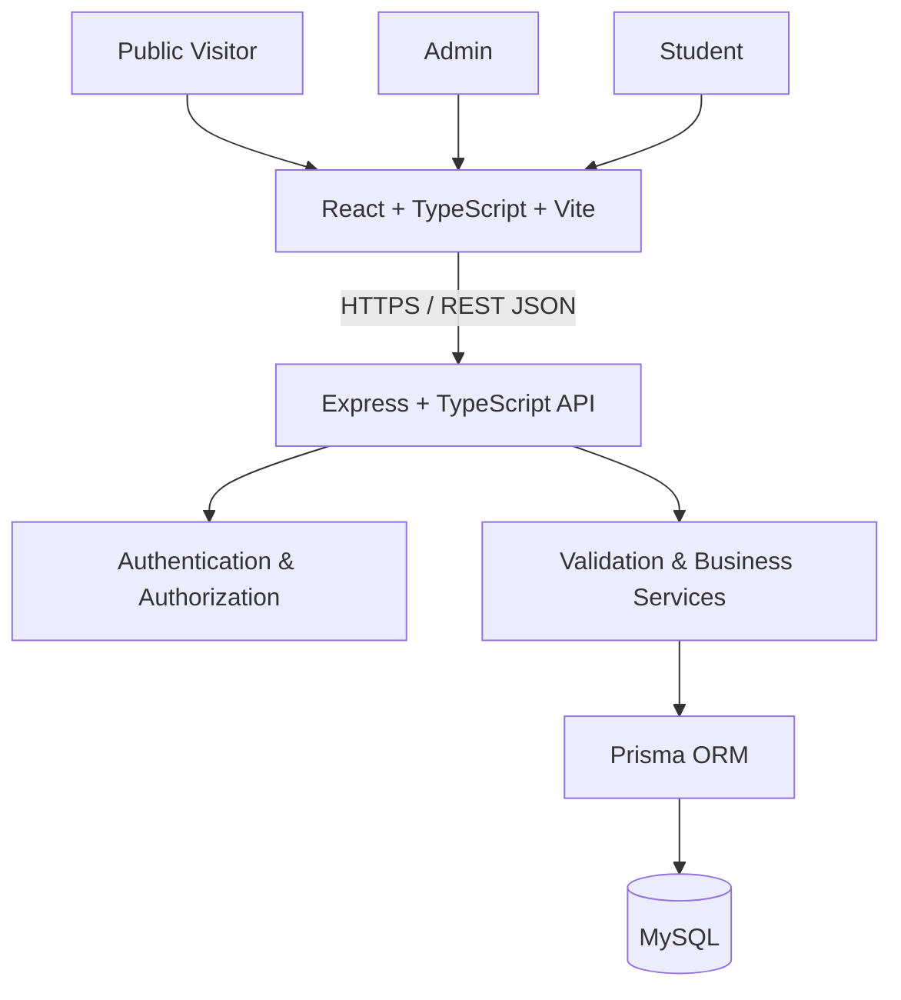

# System Architecture — Host Pilot

## 1. Architecture Goals

- Clear separation of frontend, backend, and database responsibilities.
- Modular feature organization.
- Secure server-side authorization.
- Consistent REST API contracts.
- Maintainable Prisma/MySQL data access.
- Incremental implementation and testability.

## 2. High-Level Architecture



The frontend must never connect directly to MySQL. All protected data access must pass through the backend API.

## 3. Recommended Repository Structure

Use a single repository with separate frontend and backend applications unless a documented technical reason justifies another approach.

```text
[project-root]/
├── frontend/
│   ├── public/
│   ├── src/
│   │   ├── app/
│   │   │   ├── router.tsx
│   │   │   └── providers.tsx
│   │   ├── components/
│   │   │   ├── ui/
│   │   │   ├── shared/
│   │   │   └── forms/
│   │   ├── layouts/
│   │   │   ├── public-layout.tsx
│   │   │   ├── admin-layout.tsx
│   │   │   └── student-layout.tsx
│   │   ├── features/
│   │   │   ├── auth/
│   │   │   ├── dashboard/
│   │   │   ├── students/
│   │   │   ├── admissions/
│   │   │   ├── rooms/
│   │   │   ├── allocations/
│   │   │   ├── payments/
│   │   │   ├── expenses/
│   │   │   ├── complaints/
│   │   │   ├── notices/
│   │   │   ├── staff/
│   │   │   └── reports/
│   │   ├── hooks/
│   │   ├── lib/
│   │   ├── services/
│   │   ├── stores/
│   │   ├── i18n/
│   │   │   ├── en/
│   │   │   └── bn/
│   │   ├── types/
│   │   ├── styles/
│   │   ├── App.tsx
│   │   └── main.tsx
│   ├── package.json
│   └── ...
├── backend/
│   ├── prisma/
│   │   ├── schema.prisma
│   │   ├── migrations/
│   │   └── seed.ts
│   ├── src/
│   │   ├── config/
│   │   ├── modules/
│   │   │   ├── auth/
│   │   │   ├── users/
│   │   │   ├── students/
│   │   │   ├── admissions/
│   │   │   ├── rooms/
│   │   │   ├── allocations/
│   │   │   ├── payments/
│   │   │   ├── expenses/
│   │   │   ├── complaints/
│   │   │   ├── notices/
│   │   │   ├── staff/
│   │   │   └── reports/
│   │   ├── middlewares/
│   │   ├── utils/
│   │   ├── app.ts
│   │   └── server.ts
│   ├── tests/
│   ├── package.json
│   ├── tsconfig.json
│   ├── .env.example
│   └── ...
├── docs/
│   ├── project-overview.md
│   ├── requirements.md
│   ├── architecture.md
│   ├── database-design.md
│   ├── api-documentation.md
│   └── development-roadmap.md
├── .gitignore
└── README.md
```

Do not create every possible file or module as empty boilerplate. Create folders and files incrementally when the corresponding phase begins.

## 4. Frontend Responsibilities

- Render public, admin, and student experiences.
- Handle client-side navigation and presentation.
- Call backend REST APIs through a centralized API client.
- Manage server state with TanStack Query.
- Manage local UI state with React state or a small state store only when needed.
- Validate forms for usability; the backend remains authoritative.
- Load translated strings from localization resources.
- Display loading, empty, error, and success states.

Suggested frontend layers:
- `features/`: domain-specific pages and components.
- `services/`: API functions.
- `components/`: shared reusable UI.
- `layouts/`: public/admin/student shells.
- `lib/`: shared utilities and API client.
- `i18n/`: translations and language setup.

## 5. Backend Responsibilities

Use a modular Express architecture. A typical feature module may contain:
- `*.routes.ts` — route definitions.
- `*.controller.ts` — HTTP request/response handling.
- `*.service.ts` — business logic.
- `*.repository.ts` — database access when separation is useful.
- `*.schema.ts` — Zod validation schemas.
- `*.types.ts` — feature-specific types.

Keep controllers thin. Do not put all business logic in route handlers. Do not expose Prisma models directly as public API contracts without deliberate mapping.

Middleware responsibilities:
- Authentication.
- Authorization.
- Request validation.
- Centralized error handling.
- Request logging and request IDs.
- Rate limiting and security headers.

## 6. Database Access

- MySQL is the relational database.
- Prisma is the ORM/data access layer.
- Use migrations for schema changes.
- Keep schema changes reviewed and version-controlled.
- Use transactions for critical multi-step workflows.
- Use explicit select/include fields to avoid leaking private columns.
- Use pagination for list endpoints.
- Add indexes based on expected filtering, sorting, joins, and uniqueness rules.

**Prisma version note:** Prisma's configuration and MySQL driver setup can differ by major version. Before implementation, check the current official Prisma documentation and follow one consistent setup for the installed version. Do not mix Prisma 6 and Prisma 7 configuration examples. If the selected Prisma version requires a MySQL driver adapter, configure and test that adapter explicitly.

## 7. Authentication Strategy

The implementation plan must compare and select one secure strategy:
- Server-managed sessions with secure cookies, or
- Short-lived access tokens with a carefully designed refresh strategy.

If cookies are used:
- Configure HttpOnly, Secure in production, and an appropriate SameSite policy.
- Add CSRF protection where required.
- Configure CORS with explicit trusted origins and credentials only where needed.

Never store long-lived authentication secrets in browser localStorage by default. Never rely on frontend role checks alone.

## 8. API Conventions

- Prefix API routes with `/api/v1`.
- Use JSON request and response bodies.
- Use consistent status codes.
- Validate all incoming parameters, query strings, and bodies.
- Return a consistent error envelope.
- Use pagination metadata for list responses.
- Avoid returning password hashes, secret fields, or unnecessary personal data.

Proposed success envelope:

```json
{
  "success": true,
  "data": {},
  "message": "Operation completed"
}
```

Proposed error envelope:

```json
{
  "success": false,
  "error": {
    "code": "VALIDATION_ERROR",
    "message": "The submitted data is invalid",
    "details": []
  }
}
```

## 9. Environment Strategy

- Keep frontend and backend environment variables separate.
- Commit `.env.example` with placeholder values only.
- Add `.env`, build output, dependencies, logs, and secrets to `.gitignore`.
- Validate required environment variables at startup.
- Document each variable and its purpose.
- Never expose backend secrets through Vite's `VITE_` variables.

## 10. Development Workflow

Follow this exact master order:
1. Documentation and architecture approval.
2. Project folder and repository structure.
3. Development environment setup.
4. Frontend foundation and UI design tokens.
5. Frontend feature pages and verification.
6. Backend foundation and API core.
7. Prisma and MySQL integration.
8. Backend business modules and persistence.
9. Frontend, backend, and database end-to-end integration.
10. Testing, security review, and final verification.

The owner approves each phase before the next phase begins.
