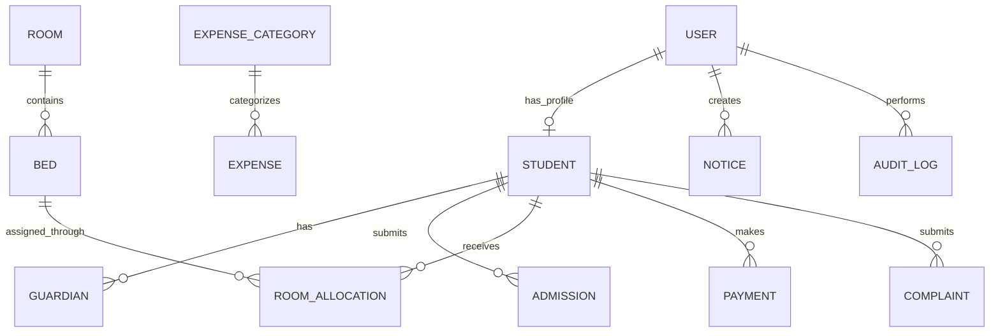

# Database Design — Host Pilot

> This is a proposed logical design, not permission to run migrations or create a database. Confirm unresolved business rules before finalizing the Prisma schema.

## 1. Database Principles

- Database: MySQL.
- ORM: Prisma.
- Use relational normalization and explicit foreign-key relationships.
- Use exact decimal types for money.
- Use unique constraints for identifiers and business invariants.
- Preserve historical payment and allocation records.
- Use transactions for multi-step operations.
- Avoid destructive deletion of records referenced by financial or operational history.
- Store timestamps consistently and document the application timezone (proposed: Asia/Dhaka).

## 2. Proposed Entities

### User
Purpose: authentication identity and role.
- `id`
- `name`
- `email` (unique)
- `passwordHash`
- `role` (initial proposal: ADMIN, STUDENT; additional roles only after approval)
- `status`
- `createdAt`
- `updatedAt`

### Student
Purpose: student-specific profile.
- `id`
- `userId` (unique relation to User, if every student has a login)
- `studentCode` (unique)
- `phone`
- `address`
- `dateOfBirth` (only if required)
- `status`
- `createdAt`
- `updatedAt`

### Guardian
- `id`
- `studentId`
- `name`
- `phone`
- `relationship`
- Optional contact/address fields as approved.

### Admission
- `id`
- `applicationNumber` (unique string, e.g. `ADM-YYYYMMDD-XXXX`)
- `applicantName`
- `email`
- `phone`
- `address`
- `guardianName`
- `guardianPhone`
- `preferredRoomType`
- `status` (`PENDING`, `APPROVED`, `REJECTED`, `WITHDRAWN`)
- `appliedAt`
- `reviewedAt` (nullable)
- `reviewedByUserId` (nullable)
- `decisionNote` (nullable)
- `studentId` (nullable, linked to created Student upon approval)
- Workflow: Public visitor submits application without prior account. On approval, Admin converts applicant to enrolled Student with User credentials.

### Room
- `id`
- `roomNumber` (unique string within hostel)
- `floor` (integer)
- `capacity` (integer matching bed count)
- `roomType` (e.g. SINGLE, DOUBLE, TRIPLE, DORMITORY)
- `monthlyRent` (Decimal: 12, 2)
- `status` (`AVAILABLE`, `FULL`, `MAINTENANCE`)
- `createdAt`
- `updatedAt`

### Bed
- `id`
- `roomId` (relation to Room)
- `bedCode` or `bedNumber` (e.g., `A`, `B`, `1`, `2` — unique per room)
- `status` (`AVAILABLE`, `OCCUPIED`, `MAINTENANCE`)
- `createdAt`
- `updatedAt`

### RoomAllocation
- `id`
- `studentId` (relation to Student)
- `bedId` (relation to Bed, unique constraint on active allocation)
- `startDate` (DateTime)
- `endDate` (nullable DateTime while active)
- `status` (`ACTIVE`, `VACATED`, `TRANSFERRED`)
- `allocatedByUserId` (relation to User/Admin)
- `createdAt`

### Payment
- `id`
- `studentId` (relation to Student)
- `billingPeriod` (canonical date or string: `YYYY-MM`)
- `amount` (Decimal: 12, 2)
- `paidAmount` (Decimal: 12, 2)
- `status` (`PAID`, `PARTIAL`, `DUE`)
- `paymentMethod` (`CASH`, `BANK_TRANSFER`, `BKASH`, `NAGAD`)
- `receiptNumber` (unique string)
- `transactionReference` (nullable string)
- `paidAt` (DateTime)
- `recordedByUserId` (relation to User/Admin)
- `createdAt`

### Expense
- `id`
- `categoryId` (relation to ExpenseCategory)
- `amount` (Decimal: 12, 2)
- `description` (string)
- `expenseDate` (DateTime)
- `recordedByUserId` (relation to User/Admin)
- `createdAt`

### ExpenseCategory
- `id`
- `name` (unique string, e.g. UTILITIES, MAINTENANCE, FOOD, SALARY)
- `description` (nullable string)
- `isActive` (boolean, default true)

### Complaint
- `id`
- `studentId` (relation to Student)
- `subject` (string)
- `description` (text)
- `status` (`PENDING`, `IN_PROGRESS`, `RESOLVED`, `REJECTED`)
- `createdAt` (DateTime)
- `updatedAt` (DateTime)
- `resolvedAt` (nullable DateTime)

### Notice
- `id`
- `title` (string)
- `content` (text)
- `status` (`DRAFT`, `PUBLISHED`, `ARCHIVED`)
- `publishedAt` (nullable DateTime)
- `createdByUserId` (relation to User/Admin)
- `createdAt` (DateTime)
- `updatedAt` (DateTime)

### Staff (TBC — Deferred Post-MVP)
- `id`
- `name`
- `phone`
- `designation`
- `salary` (Decimal: 12, 2)
- `status` (`ACTIVE`, `INACTIVE`)
- Note: Staff records in MVP exist solely as metadata managed by Admin. Independent staff logins/roles are deferred post-MVP.

### AuditLog
- `id`
- `actorUserId`
- `action`
- `entityType`
- `entityId`
- `metadata` (avoid secrets and unnecessary personal data)
- `createdAt`

### HostelSettings
- `id`
- `hostelName`
- `address`
- `contactPhone`
- `contactEmail`
- `currencyCode` (proposed BDT)
- `timezone` (proposed Asia/Dhaka)

## 3. Relationship Summary

- User 1 — 0/1 Student.
- Student 1 — many Guardians.
- Student 1 — many Admissions only if reapplication/history is allowed; otherwise define a unique active application rule.
- Room 1 — many Beds.
- Student 1 — many RoomAllocations over time.
- Bed 1 — many RoomAllocations over time, but no overlapping active allocation.
- Student 1 — many Payments or Invoices, depending on billing design.
- ExpenseCategory 1 — many Expenses.
- Student 1 — many Complaints.
- User 1 — many created Notices.
- User 1 — many AuditLogs.

## 4. Mermaid ER Diagram (Conceptual)

This diagram is conceptual. Final cardinalities and optional relationships must match the approved workflows.

## 5. Critical Constraints and Integrity Rules

1. Unique email for User.
2. Unique student code.
3. Unique application number.
4. Unique room number within the hostel.
5. Unique bed number/code within a room.
6. Room capacity must be consistent with its bed inventory or allocation model.
7. A bed must not have overlapping active allocation periods.
8. A student must not have conflicting active allocations unless explicitly permitted.
9. Duplicate billing for a student and billing period must be prevented according to the approved invoice/payment model.
10. Financial amounts must use `DECIMAL`/Prisma `Decimal`, not JavaScript floating-point arithmetic.
11. Use transactions for allocation, admission approval plus allocation, and financial workflows where multiple writes must succeed together.
12. Consider concurrent requests: application-level checks alone are insufficient for race conditions. Use database constraints and an appropriate transaction/locking strategy.

## 6. Indexing Guidance

Evaluate indexes for:
- User email and role.
- Student code and status.
- Admission status and applied date.
- Room floor/status.
- Bed room ID and status.
- Allocation student ID, bed ID, status, and date range.
- Payment student ID, billing period, status, and paid date.
- Complaint student ID, status, and created date.
- Notice status and published date.
- Audit log actor, entity, and timestamp.

Do not add every possible index blindly; confirm query patterns and avoid redundant indexes.

## 7. Data Lifecycle

- Prefer `ACTIVE`, `INACTIVE`, `ARCHIVED`, or status changes over hard deletion where history matters.
- Define retention and archival rules.
- Never cascade-delete payment history because a student profile is deactivated.
- Define what happens when a room or bed is retired while historical allocations exist.
- Seed only clearly labeled development/test data. Never seed default production credentials.

## 8. Status of Database Decisions

### Confirmed Decisions for MVP:
- **Bed-level Allocation:** Confirmed. Individual physical beds are tracked in the `Bed` entity; `RoomAllocation` links `studentId` to `bedId`.
- **Single Hostel:** Confirmed for MVP. Single-hostel operational scope, extensible schema.
- **Admission Workflow:** Confirmed. Public application without prior login. Conversion to `Student` and `User` upon Admin approval.
- **Roles in Schema:** Confirmed. `role` enum contains `ADMIN` and `STUDENT`. Staff login is deferred post-MVP.
- **Currency & Precision:** Confirmed. All financial columns use `DECIMAL(12, 2)`.
- **Preservation of History:** Confirmed. Active/Vacated status on allocations; no hard delete on students with payment/allocation history.

### Unresolved Items (Marked TBC):
- **Online Payment Gateway & Webhooks:** *TBC* (Deferred post-MVP).
- **Automated Recurring Invoices vs Manual Monthly Billing:** *TBC* (Manual monthly billing records implemented in MVP).
- **Staff User Accounts:** *TBC* (Metadata only in MVP; independent accounts deferred).
- **Mandatory Guardian Count:** Default 1 primary guardian required during admission.

## 9. Migration Safety

- Generate and review migrations.
- Do not use destructive reset commands on any database containing valuable data.
- Back up data before risky schema changes.
- Test migrations on a development database first.
- Never run production migration or destructive database command without explicit owner approval.
